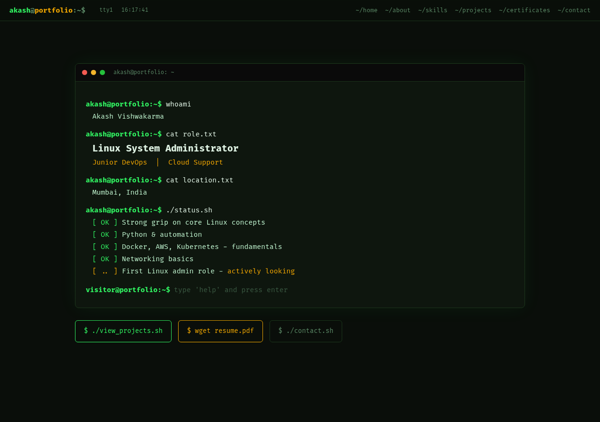

# Akash Vishwakarma

**Portfolio:** https://akash991833.github.io

Aspiring Linux System Administrator | Junior DevOps / Cloud Support | Mumbai

I am a fresher focused on Linux administration and automation. I work with Linux and Bash/Python, and I am learning Docker, AWS, Kubernetes and networking. I use AI tools to speed up learning and development, while checking the results myself.

## Linux & DevOps projects (start here)

Three production-style Bash toolkits. Every one ships a full test-suite, honest test reports, and CI that proves it on real machines - Ubuntu VMs **and** a 5-distro Red Hat family matrix (Rocky 9, AlmaLinux 9, CentOS Stream 9, Fedora, Red Hat UBI 9).

- **[linux-server-hardening-monitoring](https://github.com/AKASH991833/linux-server-hardening-monitoring)** - Audit a server against 43 security checks (0-100 score + grade), fix safely with dry-run + byte-identical rollback + SSH anti-lockout guard, detect drift from a baseline, and monitor health with flap-suppressed alerts (webhook/Telegram/mail, mock-server-tested) and Prometheus export.
- **[nginx-mysql-ssl-backup-webstack](https://github.com/AKASH991833/nginx-mysql-ssl-backup-webstack)** - One command per site: hardened Nginx (TLS 1.2/1.3, security headers, rate limiting) + MariaDB with least-privilege users + backups **proven restorable by real restore tests** + GFS retention + cert watchdog + health checks. Includes a docker-compose lab verified in CI.
- **[sysadmin-automation-toolkit](https://github.com/AKASH991833/sysadmin-automation-toolkit)** - The daily admin jobs as one safe tool: declarative user sync from CSV (plan-first, idempotent, ownership tags), one-command offboarding, incremental tar backups that replay deletions, safe log cleanup, and a maintenance runner with timeouts and overlap lock.

Each repo has an [INTERVIEW.md](https://github.com/AKASH991833/linux-server-hardening-monitoring/blob/main/INTERVIEW.md) with the architecture, design choices and 10 interview Q&A.

## Other featured projects

- [server-monitoring](https://github.com/AKASH991833/server-monitoring) - Bash monitoring for CPU, RAM, disk, inodes and services with threshold alerts and daily HTML reports. Tested on a real Ubuntu 24.04 runner in GitHub Actions.
- [linux-dupe-audit](https://github.com/AKASH991833/linux-dupe-audit) - Safe Python CLI that finds exact duplicate files (SHA-256) and visually similar photos. Never deletes by default.
- [multi-tool](https://github.com/AKASH991833/multi-tool) - Browser-based image, PDF and text utilities that run fully on the device. Live at [akash991833.github.io/multi-tool](https://akash991833.github.io/multi-tool/).
- [linux-app](https://github.com/AKASH991833/linux-app) - Offline Android app for learning Linux: lessons, chapter-wise quizzes and interview Q&A.

## Currently learning

Linux administration, shell workflows, networking, Docker, AWS and Kubernetes.

I am looking for entry-level Linux system administration, junior DevOps and cloud support opportunities in Mumbai.

Portfolio: [akash991833.github.io](https://akash991833.github.io)
